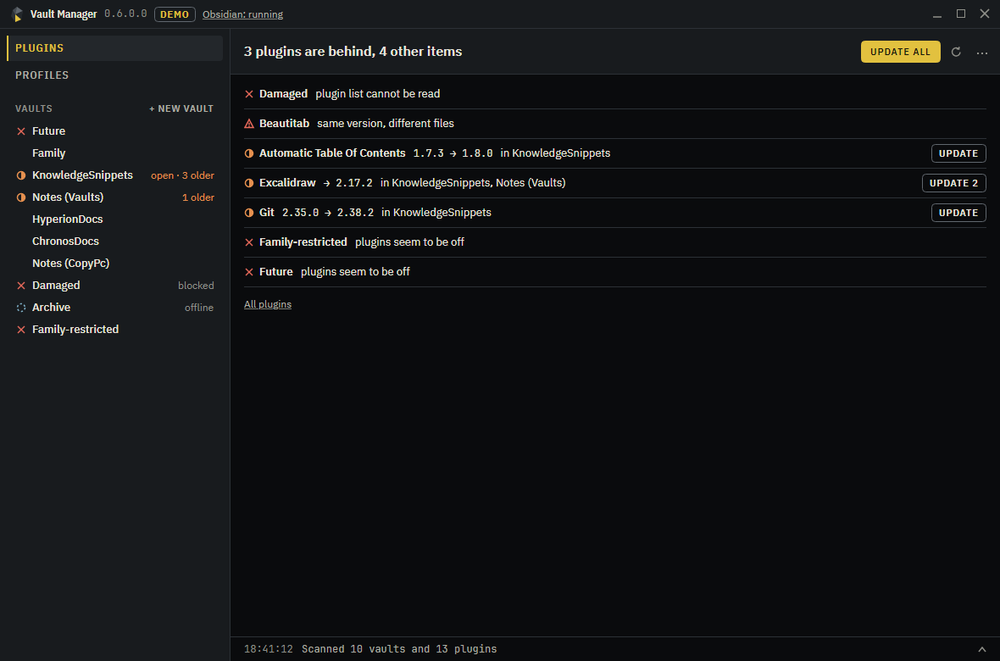

# Vault Manager

Manage Obsidian across all your vaults from one window, with Obsidian closed if you like. See which plugins differ between vaults, bring them in line, set up new vaults from a profile, and undo what you did. Nothing needs installing into a vault.



## What it does

- **Shows what needs attention.** Plugins that differ between vaults, vaults with plugins turned off, gaps against a profile, and the same plugin version with different files, which can be a warning sign.
- **Copies before it downloads.** A plugin that exists in another vault comes from there, with no traffic. Downloads from the official catalog happen only on a click, and the size is shown first.
- **Updates in one click, and takes it back in one.** A copy is saved before anything is written, and Undo works after a restart.
- **Keeps your settings.** An update leaves a plugin's settings alone. Settings holding a key or a token do not travel to other vaults.
- **Leaves open vaults alone.** Changes for an open vault wait until you close it, and changes for an unplugged drive wait for the drive. Then they finish by themselves, even after a restart of the app.
- **Profiles.** A profile is a plain file with plugins, folders, templates and settings. Create, edit, import and export them, check a vault against one, or create a new vault from one.
- **Settings sync.** Copy hotkeys, appearance, editor and plugin settings between vaults. It compares against the last time two vaults agreed, so it knows who changed what and asks only when both did.

## When not to use it

- To sync notes between devices. Use Obsidian Sync or Git.
- On a phone. It is a Windows desktop app.
- If you want plugins managed from inside Obsidian, try [Extension Hub](https://community.obsidian.md/plugins/extension-hub) or [Vault Extension Sync](https://community.obsidian.md/plugins/vault-plugin-sync).

## Download

Get the self-contained Windows x64 exe from the [Releases page](https://github.com/IoannTerrible/ObsidianVaultManager/releases). No .NET install is needed.

Try it without touching anything:

```bash
VaultManager-v0.6.0.0-win-x64.exe --demo
```

The demo runs on a throwaway set of vaults and uses no network.

## Where things live

| What | Where |
| :-- | :-- |
| Vault list | Read from `%APPDATA%\obsidian\obsidian.json` |
| Profiles | `%LOCALAPPDATA%\TechTeaStudio\VaultManager\profiles` |
| Journal, undo, decisions | `%LOCALAPPDATA%\TechTeaStudio\VaultManager\vault-manager.db` |
| Saved copies for undo | `%LOCALAPPDATA%\TechTeaStudio\VaultManager\snapshots`, the last 20 operations |

Nothing of the app's own is kept inside a vault.

## Network

The app contacts GitHub only when you press **Check online** or install a plugin from the catalog. The first click tells you the catalog size, about 3 MB, before fetching it. No telemetry.

## Build

The project targets .NET 6, 8, 9 and 10. Any of those SDKs will do.

```bash
dotnet build VaultManager.slnx
```

```bash
dotnet test tests/VaultManager.Tests/VaultManager.Tests.csproj
```

```bash
dotnet run --project src/VaultManager.App/VaultManager.App.csproj -f net10.0 -- --demo
```

## Release flow

`ci.yml` builds every target and runs the tests on each push and pull request to `product`. `release.yml` publishes the exe when a `v*` tag is pushed:

```bash
git tag v0.6.0.0
```

```bash
git push origin v0.6.0.0
```

## License

See [LICENSE.txt](LICENSE.txt). The embedded IBM Plex and JetBrains Mono fonts are under the SIL Open Font License.
